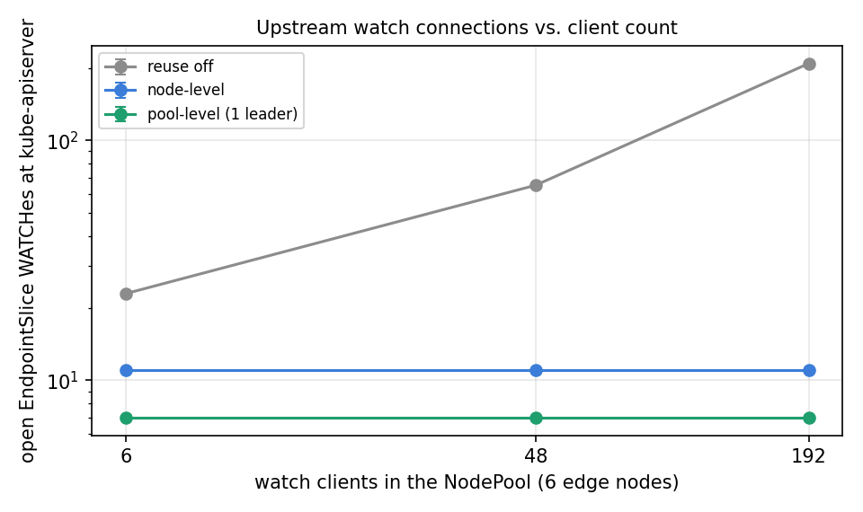
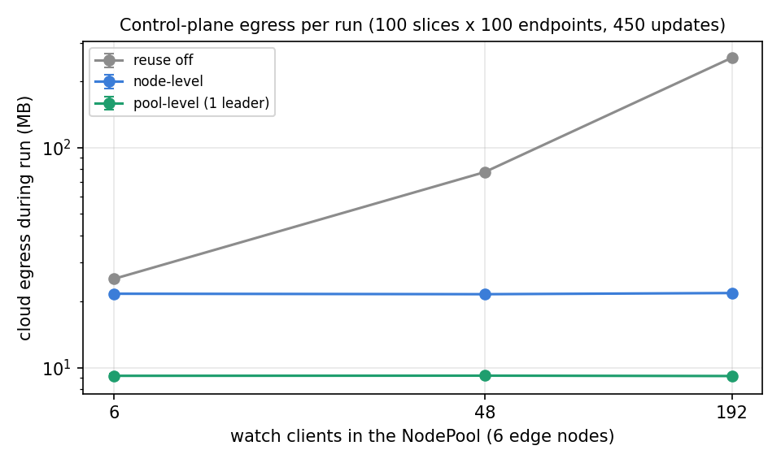
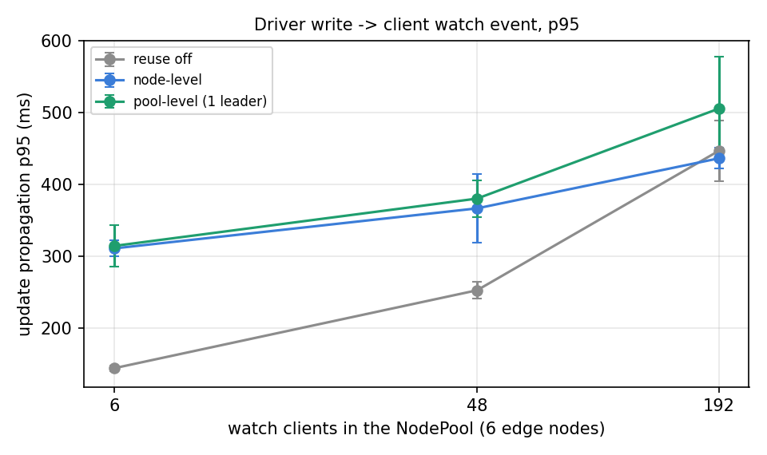

OpenYurt's design proposals estimate that [node-level list/watch reuse](https://github.com/openyurtio/openyurt/blob/master/docs/proposals/20240529-node-level-traffic-reuse-capability.md) in YurtHub cuts cloud-edge traffic by about 50%, and that [NodePool-level reuse](https://github.com/openyurtio/openyurt/blob/master/docs/proposals/20241211-reuse-nodepool-list-watch-requests.md) through a leader YurtHub can cut it by up to 90%. Those figures come from back-of-the-envelope calculations. We wanted to know what the two mechanisms do on a real cluster, what they cost on the edge side, and when the savings appear.

We ran a controlled experiment on OpenYurt v1.7.0: three reuse configurations, three client counts, two EndpointSlice sizes, three repetitions each — 36 runs in total — plus 9 more runs to locate where YurtHub adds update latency. This post describes the method, the results, and the limits of what a single-host kind cluster can tell you.

<!--truncate-->

## TL;DR

- **The saving depends on how many clients read the same data.** With reuse off, cloud egress grows linearly with the number of list/watch clients in the pool. With reuse on, it stays flat. With 6 clients (one per node), node-level reuse saved 14%; with 192 clients it saved 91%. The proposal's "50%" and "90%" are both true, just at different client counts.
- **Pool-level reuse with one leader brought cloud egress down a further ~58% compared with node-level reuse**, independent of client count. But the data still reaches every node: followers receive it from the leader over the pool's local network. Pool-level reuse moves traffic from the cloud-edge link to the edge LAN; it does not remove it.
- **Reuse is not free.** At low client counts, p95 update propagation (from write to watch event at the client) roughly doubled, from 144 ms to about 310 ms. A side-by-side test shows YurtHub's plain proxy path adds almost nothing; the extra ~80–90 ms at p50 comes from the multiplexer's cache path. YurtHub resident memory rose from about 81 MB to 104–188 MB as the cache was populated and client count grew. CPU barely changed.
- **The leader YurtHub was not a hotspot** in this setup: about 10% more CPU than a follower, and the same memory.

## What we are measuring

Since v1.6, YurtHub contains a **multiplexer**. For a configurable set of "pool-scope" resources — by default `v1/services` and `discovery.k8s.io/v1/endpointslices` — list and watch requests from local clients (kube-proxy, CoreDNS, applications using in-cluster config) are served from a single shared cache inside YurtHub, instead of each client opening its own list/watch to kube-apiserver. We call this **node-level reuse**.

v1.7.0 adds **pool-level reuse**. When a NodePool has `enableLeaderElection: true`, yurt-manager elects one or more leader YurtHubs and publishes them in the `leader-hub-<pool>` ConfigMap. Follower YurtHubs then fill their multiplexer cache from a leader YurtHub instead of from kube-apiserver. The routing decision is in `pkg/yurthub/multiplexer/multiplexer.go` (`updateLeaderHubConfiguration`) and `pkg/yurthub/proxy/proxy.go` (`ServeHTTP`).

Both mechanisms are controlled through the NodePool (`apps.openyurt.io/v1beta2`):

```yaml
spec:
  interConnectivity: true          # required for pool-level reuse; immutable
  enableLeaderElection: true       # pool-level reuse on/off
  leaderReplicas: 1
  leaderElectionStrategy: random
  poolScopeMetadata:               # which resources are multiplexed
  - {group: "", version: v1, resource: services}
  - {group: discovery.k8s.io, version: v1, resource: endpointslices}
```

That gives three configurations ("arms") we can compare on the same cluster:

| Arm | `poolScopeMetadata` | `enableLeaderElection` | Upstream for EndpointSlice list/watch |
|---|---|---|---|
| **off** | services only | false | every client, forwarded individually to kube-apiserver |
| **node** | services + endpointslices | false | one per YurtHub, to kube-apiserver |
| **pool** | services + endpointslices | true, 1 leader | one from the leader to kube-apiserver; followers from the leader |

"Off" removes only EndpointSlices from multiplexing; Services stay multiplexed in all three arms, so differences come from the EndpointSlice path alone.

## Experiment setup

**Environment.** OpenYurt v1.7.0 (tag `35ef4cd`), released `yurt-manager`, `yurthub` and `node-servant` images; Kubernetes v1.34.3 on kind v0.31.0, containerd 2.2.0. The cluster was created with OpenYurt's own `test/e2e` `init` tool, with one change: all six worker nodes were placed in a single edge NodePool (`yurt-pool2`) so that one pool has one leader and five followers. Everything ran on a single Apple M5 machine (10 cores, 24 GiB RAM), inside a Docker VM with 10 vCPU and 7.7 GiB. No other containers were running.

**Switching arms.** For each arm we patched the NodePool, waited for the `leader-hub-yurt-pool2` ConfigMap to reflect the change, restarted YurtHub on every edge node so all upstream connections were re-established under the new configuration, and waited until the number of open EndpointSlice watches at kube-apiserver was stable.

**Clients.** A small Go load generator (client-go) ran as one pod per edge node with *C* independent clients. Each client opened its own TCP connection, listed all EndpointSlices cluster-wide, and then watched them — the same pattern as kube-proxy. Pods used ordinary in-cluster configuration, which YurtHub rewrites to its local address, so client traffic went through YurtHub exactly as application traffic would. *C* ∈ {1, 8, 32}, i.e. 6, 48 and 192 clients in the pool.

**Objects and updates.** A driver pod on the control-plane node created *K* EndpointSlices with *E* endpoints each (the main size was 100 × 100, i.e. 10,000 endpoints; a small size of 20 × 10 was run at *C* = 8). It then patched them for 30 s at 5 updates/s, followed by three bursts that each touched every slice. Every patch carried a nanosecond timestamp annotation; clients recorded how long each event took to arrive. The driver and clients share the Docker VM's kernel clock, so the latency is not affected by host clock skew.

**Measurements.**

- *kube-apiserver*: open EndpointSlice WATCH requests (`apiserver_longrunning_requests`), number and size of LIST responses (`apiserver_request_total`, `apiserver_response_sizes_sum`).
- *Wire bytes*: `eth0` transmit bytes on the control-plane container (our proxy for cloud egress) and receive bytes on each edge node.
- *YurtHub*: `process_cpu_seconds_total` and `process_resident_memory_bytes` on every edge node, separated into leader and followers in the pool arm.
- *Clients*: list latency and update propagation latency (p50/p95/p99).

We first tried `apiserver_watch_events_sizes_sum` as a byte counter, but in this setup it did not scale with the number of watchers (65 watchers reported fewer bytes than 11), so it does not measure bytes sent per watcher. We used interface counters instead.

Each cell was repeated three times, alternating arm order between repetitions. Numbers below are mean ± standard deviation over the three runs. Every run delivered every expected event to every client, and no client reported an error.

## Results

### 1. Upstream connections and LISTs



| Clients in pool | Open watches: off | node | pool | LISTs per run: off | node | pool |
|---|---|---|---|---|---|---|
| 6   | 23  | 11 | 7 | 6   | 0 | 0 |
| 48  | 65  | 11 | 7 | 48  | 0 | 0 |
| 192 | 209 | 11 | 7 | 192 | 3 ± 2 | 1 |

About 5 of these watches come from components outside the edge pool. In the "off" arm, kube-proxy and CoreDNS on each of the six edge nodes add 12 more, and then every test client adds one watch and one full LIST at kube-apiserver. With node-level reuse, the count is flat: one upstream watch per YurtHub plus the baseline, regardless of how many local clients there are. With one pool leader it drops to 7; we did not attribute the extra watch beyond the leader's own.

### 2. Cloud egress



Control-plane egress per run (about 2 minutes, 450 updates), 100 × 100-endpoint slices:

| Clients in pool | off | node | pool | node vs off | pool vs off |
|---|---|---|---|---|---|
| 6   | 25.3 ± 0.2 MB  | 21.7 ± 0.2 MB | 9.2 ± 0.2 MB | −14% | −64% |
| 48  | 77.4 ± 0.3 MB  | 21.6 ± 0.1 MB | 9.2 ± 0.1 MB | −72% | −88% |
| 192 | 256.3 ± 0.9 MB | 21.8 ± 0.2 MB | 9.2 ± 0.0 MB | −91% | −96% |

With the small object set (20 × 10, 48 clients): 15.7 MB (off), 5.0 MB (node, −68%), 3.4 MB (pool, −79%).

Two things stand out:

1. **Node-level reuse only pays when several clients on a node read the same resource.** With one reader per node, the saving was 14%. In a real cluster kube-proxy and CoreDNS already give at least two readers per node, and every application that lists Services or EndpointSlices adds another — but the saving is a property of your workload, not a constant.
2. **Pool-level reuse brings cloud egress to roughly one node's worth**, which is why the pool arm is flat at about 9.2 MB regardless of client count. These figures include a fixed amount of unrelated control-plane traffic (node heartbeats, leases, other watches), so the reduction for EndpointSlice traffic alone is larger than the percentages shown.

### 3. Where the bytes go in pool mode

Total bytes *received* by the six edge nodes:

| Clients in pool | off | node | pool |
|---|---|---|---|
| 6   | 23.5 MB  | 19.9 MB | 20.1 MB |
| 192 | 254.4 MB | 20.0 MB | 20.3 MB |

In pool mode, edge receive traffic is the same as in node mode. Followers still receive the full update stream; it comes from the leader over the pool's network instead of from the cloud. This is the intended design — `interConnectivity: true` is required because the pool network carries this traffic — and it matches the proposal's goal of reducing *cloud-edge* traffic. It also means pool-level reuse is most valuable where the cloud link is the expensive or constrained one and the edge LAN is cheap.

### 4. Update propagation latency



Time from the driver's write to the event reaching the client (100 × 100 slices):

| Clients in pool | p95 off | p95 node | p95 pool | p50 off | p50 node | p50 pool |
|---|---|---|---|---|---|---|
| 6   | 144 ± 4 ms  | 311 ± 11 ms | 314 ± 29 ms | 71 ms  | 147 ms | 143 ms |
| 48  | 253 ± 12 ms | 367 ± 47 ms | 380 ± 26 ms | 99 ms  | 165 ms | 178 ms |
| 192 | 447 ± 43 ms | 436 ± 14 ms | 506 ± 73 ms | 156 ms | 192 ms | 213 ms |

At low client counts, the multiplexer adds latency: p50 and p95 roughly double. As the client count grows, the "off" arm gets slower (kube-apiserver has to fan out to more watchers), and the gap closes; at 192 clients node-level reuse and no reuse are equivalent. Pool mode adds a hop and was slightly slower than node mode, but within the run-to-run variance at 6 and 48 clients.

**Where does the extra latency come from?** To find out, we ran a second experiment (9 runs: three arms × three repetitions, 100 × 100 slices). Each edge node ran two clients side by side: one through YurtHub as before, and one connecting directly to kube-apiserver with the same credentials. Comparing the two on the same node in the same run isolates the delay YurtHub adds:

| Arm | Direct to kube-apiserver p50 / p95 | Through YurtHub p50 / p95 | Added by YurtHub p50 / p95 |
|---|---|---|---|
| off (plain proxy) | 110 / 266 ms | 110 / 269 ms | ≈ 0 / +3 ms |
| node (multiplexer) | 70 / 176 ms | 151 / 323 ms | +81 / +147 ms |
| pool (multiplexer, via leader) | 64 / 231 ms | 158 / 423 ms | +93 / +192 ms |

YurtHub's plain proxy path adds essentially nothing. The extra delay comes from the multiplexer's cache path: in v1.7.0 this is a `k8s.io/apiserver` cacher fed by YurtHub's own upstream watch, with YurtHub's response filters applied to each event before it is sent to the client (`pkg/yurthub/multiplexer/cache.go`, `filterwatch.go`). Fetching from the leader adds roughly another 10 ms at p50. We did not profile which of these stages accounts for the time; that is the natural next step. Delays of this size are unlikely to matter for kube-proxy, but they are worth knowing for consumers that react to endpoint changes in real time.

On the other hand, **list latency improved** with reuse at low and medium client counts: p50 for the initial LIST of 10,000 endpoints dropped from 46 ms to 8–9 ms (6 clients) and from 72 ms to 35–43 ms (48 clients), because the list is served from the local cache.

### 5. YurtHub CPU and memory

| Clients in pool | CPU-s per run: off | node | pool follower | pool leader | RSS: off | node | pool follower | pool leader |
|---|---|---|---|---|---|---|---|---|
| 6   | 0.96 | 0.93 | 0.89 | 1.01 | 81 MB | 104 MB | 100 MB | 102 MB |
| 48  | 1.14 | 1.10 | 1.09 | 1.21 | 82 MB | 142 MB | 137 MB | 145 MB |
| 192 | 1.38 | 1.48 | 1.47 | 1.62 | 87 MB | 188 MB | 183 MB | 188 MB |

CPU per run was nearly identical across arms; the leader used about 10% more than a follower. Memory is the visible cost: with reuse on, YurtHub holds the EndpointSlice cache (10,000 endpoints here) plus per-watcher buffers, and RSS grew with the number of local watchers. For the small object set we do not report memory, because YurtHub was not restarted between cells and RSS carried over from the preceding larger cell.

## Limitations

- **One host, one VM.** All "network" traffic crossed a virtual bridge. We measured *bytes*, which do not depend on link quality, but we did not measure behaviour on real WAN links with latency, loss or bandwidth caps, where the effect on propagation latency could be larger.
- **One pool of six nodes, one leader.** The [OpenYurt roadmap](https://github.com/openyurtio/openyurt/blob/master/ROADMAP.md) asks for YurtHub benchmarks at 50, 100 and 200 nodes. Byte savings in pool mode should scale with followers per leader, but we have not measured that here, and we did not test `leaderReplicas` > 1, leader failover, or the `mark` election strategy.
- **Synthetic workload.** Clients were list/watch loops, not real kube-proxy instances, and the object churn was driven by direct patches, not by Deployments rolling out.
- **Fixed background traffic** is included in cloud egress in all arms. Percentages therefore understate the reduction in EndpointSlice traffic alone.
- **Memory for the small object set** is confounded (see above).

## Takeaways for operators

1. Turn on node-level reuse (the default) if more than one component on each node lists Services or EndpointSlices — which is almost always the case. The saving grows with each additional reader.
2. Turn on pool-level reuse (`enableLeaderElection: true`) when cloud-edge bandwidth is the constraint and nodes in the pool have a good local network. In our test it cut cloud egress by a further ~58% for a six-node pool; it does not reduce traffic inside the pool.
3. Budget YurtHub memory for the size of your pool-scope resources and the number of local watchers. In this test RSS more than doubled at 32 watchers per node.
4. If you have consumers that react to endpoint changes in under a few hundred milliseconds, measure propagation latency in your environment before and after enabling reuse.

## Reproducing this

The cluster was created with OpenYurt's `test/e2e` `init` tool (`--kubernetes-version=v1.34 --openyurt-version=v1.7.0 --node-num=7`), with the worker-to-pool mapping in `test/e2e/cmd/init/init.go` changed so that all workers join `yurt-pool2`. The load generator, orchestration script, raw per-run data (`results.jsonl`) and analysis script are available at [github.com/mohiadeen-ameer/openyurt-reuse-bench](https://github.com/mohiadeen-ameer/openyurt-reuse-bench).

Feedback and follow-up measurements — especially on real edge links and larger pools — are very welcome in the OpenYurt community.
